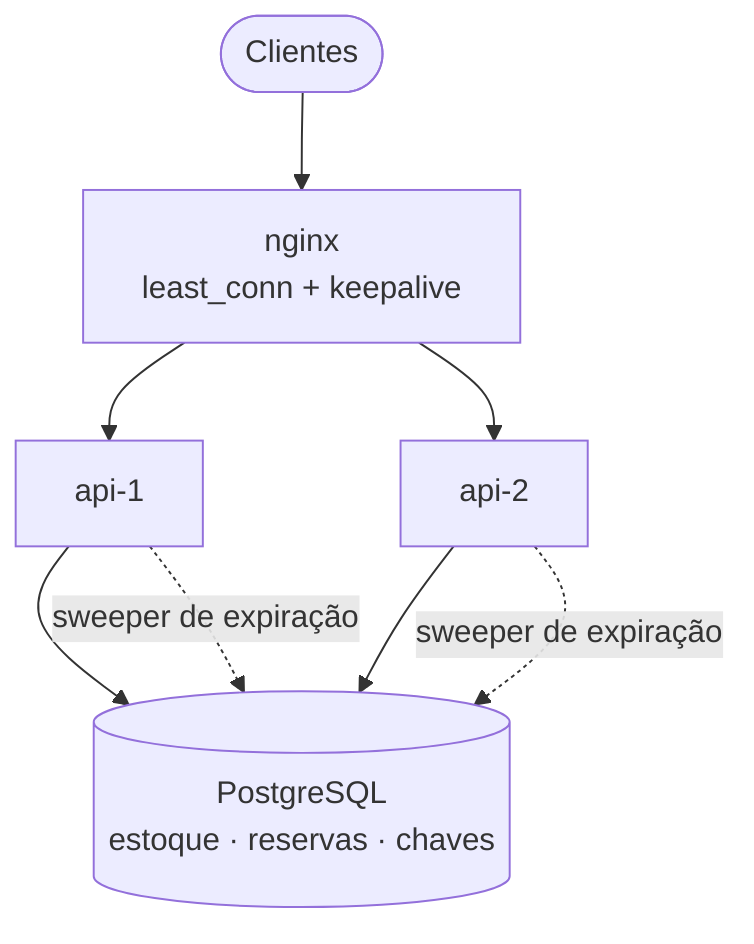
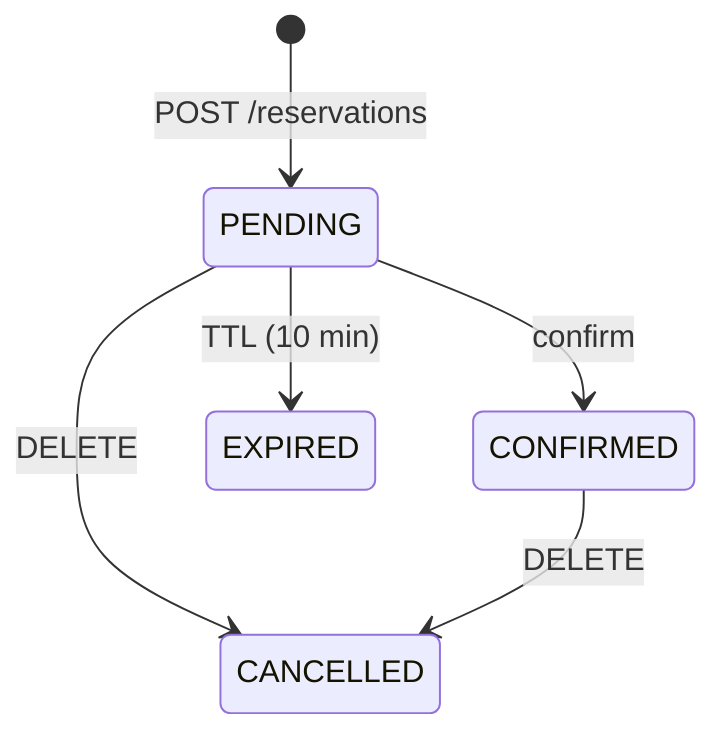

<div align="center">

# Ticket Brasil

**Reserva de ingressos para flash sales: milhares de pessoas, poucos assentos, zero oversell.**

[](https://github.com/genorchiomento/ticket-brasil/actions/workflows/ci.yml)


[Quick start](#quick-start) · [API](#api) · [Configuração](#configuração) · [Arquitetura](docs/ARCHITECTURE.md) · [Trade-offs](#decisões-e-trade-offs) · [Débitos técnicos](#débitos-técnicos) · [Evoluções](#evoluções-futuras)

</div>

---

## O problema

Quando um show abre as vendas, milhares de pessoas tentam os mesmos assentos no mesmo segundo. É aí que
aparecem os bugs clássicos: vender mais ingressos do que existem, cobrar duas vezes quem clicou duas vezes
e prender assentos de quem desistiu no meio da compra.

O **Ticket Brasil** é o núcleo de reservas que resolve isso. Ele roda em várias instâncias atrás de um
load balancer, com o PostgreSQL como única fonte da verdade, sem Redis, filas ou locks distribuídos.

## Destaques

- **Zero oversell, comprovado.** O estoque é decrementado por um único `UPDATE` condicional e atômico.
  Num teste de carga com 1.000 requisições para 100 assentos, saem exatamente 100 reservas.
- **Retry seguro.** Toda reserva exige `Idempotency-Key`: repetir a requisição devolve a mesma reserva,
  mesmo com retries simultâneos em instâncias diferentes.
- **Assentos voltam sozinhos.** Reservas não confirmadas expiram após um TTL e os assentos voltam ao
  estoque. Cada instância roda um sweeper com `SKIP LOCKED`, sem eleição de líder.
- **Escala horizontal.** As instâncias não guardam estado; a coordenação fica toda no banco.
- **Leitura barata.** A disponibilidade tem cache local de 1s, com uma única query por evento quando a
  entrada expira.
- **Erros previsíveis.** Todo erro segue a RFC 9457 (`application/problem+json`) com um `code` estável
  para o cliente tratar.

## Como funciona



A ideia central é uma linha de SQL:

```sql
UPDATE events SET available = available - :q WHERE id = :id AND available >= :q
```

Se essa instrução afeta 0 linhas, não há estoque. Ela vale para qualquer número de instâncias, porque
quem coordena a concorrência é o banco. O porquê de cada decisão e as alternativas descartadas estão em
**[docs/ARCHITECTURE.md](docs/ARCHITECTURE.md)**.

## Quick start

Pré-requisito: Docker.

```bash
git clone git@github.com:genorchiomento/ticket-brasil.git && cd ticket-brasil
docker compose up -d --build --wait    # PostgreSQL + 2 instâncias da API + nginx em :8080
./scripts/flash-sale.sh                # 1000 reservas concorrentes em 100 assentos e verificação de oversell
```

```text
  HTTP 201: 100
  HTTP 409: 900
Reservations created: 100 | available now: 0
OK: no oversell
```

> A porta 5432 já está ocupada? Use `POSTGRES_PORT=15432 docker compose up -d --build --wait`.
> Para ver reservas expirando em segundos: `RESERVATION_TTL=PT10S EXPIRATION_INTERVAL=PT1S docker compose up -d`.

## API

| Método | Rota | Descrição | Sucesso | Erros |
|---|---|---|---|---|
| `POST` | `/events` | Cria evento (`Idempotency-Key` opcional) | 201 | 400, 422 |
| `GET` | `/events/{id}` | Disponibilidade (pode estar até 1s defasada) | 200 | 400, 404 |
| `POST` | `/events/{id}/reservations` | Reserva ingressos (`Idempotency-Key` **obrigatória**) | 201 | 400, 404, 409, 422 |
| `GET` | `/reservations/{id}` | Consulta reserva | 200 | 404 |
| `DELETE` | `/reservations/{id}` | Cancela e devolve assentos (idempotente) | 200 | 404, 409 |
| `POST` | `/reservations/{id}/confirm` | Confirma, por exemplo após o pagamento (idempotente) | 200 | 404, 409 |
| `GET` | `/actuator/health` | Health check (`/liveness` e `/readiness` também) | 200 | — |

```bash
# Cria um evento
curl -X POST localhost:8080/events -H 'Content-Type: application/json' \
  -d '{"name":"Rock in Rio","startsAt":"2027-09-13T20:00:00Z","capacity":1000}'

# Reserva 2 ingressos
curl -X POST localhost:8080/events/{eventId}/reservations \
  -H 'Content-Type: application/json' -H 'Idempotency-Key: 7d1c...' \
  -d '{"customerId":"cliente-42","quantity":2}'
# 201 {"id":"...","status":"PENDING","expiresAt":"...", ...}   Idempotent-Replayed: false
```

### Ciclo de vida da reserva



### Erros

Todo erro tem um `code` estável:

| Status | `code` |
|---|---|
| 400 | `VALIDATION_ERROR` (com lista de campos), `INVALID_REQUEST`, `MALFORMED_REQUEST`, `INVALID_PARAMETER` |
| 404 | `EVENT_NOT_FOUND`, `RESERVATION_NOT_FOUND`, `NOT_FOUND` |
| 409 | `INSUFFICIENT_TICKETS` (inclui `requested`/`available`), `EVENT_ALREADY_STARTED`, `RESERVATION_EXPIRED`, `INVALID_RESERVATION_STATE` |
| 422 | `IDEMPOTENCY_KEY_REUSED` (mesma chave usada com outro payload) |
| 500 | `INTERNAL_ERROR` |

Os demais erros 4xx do framework mantêm o status e usam o nome dele como `code` (ex.: `406` → `NOT_ACCEPTABLE`).

## Configuração

Tudo é configurado por variáveis de ambiente:

| Variável | Padrão | Descrição |
|---|---|---|
| `DB_URL` | `jdbc:postgresql://localhost:5432/ticketbrasil` | URL JDBC do PostgreSQL |
| `DB_USER` | `ticket` | Usuário do banco |
| `DB_PASSWORD` | — (**obrigatória**) | Senha do banco. Não há padrão de propósito |
| `DB_POOL_SIZE` | `20` | Conexões por instância |
| `PORT` | `8080` | Porta HTTP |
| `RESERVATION_TTL` | `PT10M` | Por quanto tempo uma reserva `PENDING` segura os assentos |
| `EXPIRATION_INTERVAL` | `PT5S` | Intervalo do sweeper de expiração |
| `AVAILABILITY_CACHE_TTL` | `PT1S` | Defasagem máxima do `GET /events/{id}` (`PT0S` desliga o cache) |

## Testes

```bash
./gradlew test    # PostgreSQL real via Testcontainers (precisa de Docker)
```

São testes de integração via HTTP contra a aplicação e um Postgres reais. O que eles precisam provar
(locks, isolamento, `ON CONFLICT`, `SKIP LOCKED`) não existe em mocks ou no H2.

| Suite | O que prova |
|---|---|
| `ConcurrencyTest` | 400 requisições simultâneas em 50 assentos geram exatamente 50 reservas; 30 retries simultâneos com a mesma chave geram 1 reserva; cancelamentos concorrentes devolvem os assentos uma única vez; 6 sweepers concorrentes expiram cada reserva exatamente uma vez; disputa de lock entre confirm/cancel e o sweeper. |
| `ReservationApiTest` | Fluxo completo, idempotência, reuso de chave, limites, estados inválidos, 404s. |
| `ReservationExpirationTest` | TTL, sweeper e status efetivo antes do sweep, com `Clock` controlável e nenhum `sleep`. |
| `EventApiTest` | Criação, disponibilidade, validação, erros RFC 9457, replays. |
| `AvailabilityCacheTest` | Cache ligado: leituras e invalidação por escrita local. |

O CI (GitHub Actions) roda a suíte e o build da imagem Docker a cada push e PR.

## Stack

**Kotlin 2.3** · **Spring Boot 4** (Web MVC, `JdbcClient`) · **PostgreSQL 17** · **Flyway** · **Caffeine** ·
**Testcontainers** · **Docker Compose** · **nginx** · **GitHub Actions**

Escolhemos JDBC puro em vez de JPA de propósito: a solução *é* a semântica exata de 3–4 SQLs.

## Estrutura

```
src/main/kotlin/br/com/ticketbrasil/
├── event/          Evento, UPDATE condicional de estoque, cache de disponibilidade
├── reservation/    Máquina de estados da reserva, serviço, sweeper de expiração
├── shared/         Erros de domínio (sealed), handler RFC 9457, idempotência
└── config/         Propriedades e Clock
src/main/resources/db/migration/   Migrações Flyway
docker/ · scripts/ · docs/         nginx, teste de carga, arquitetura
```

## Decisões e trade-offs

Resumo das escolhas principais. O raciocínio completo e as alternativas descartadas estão em
[docs/ARCHITECTURE.md](docs/ARCHITECTURE.md).

| Decisão | O que ganhamos | O que custa |
|---|---|---|
| **Estoque decrementado por `UPDATE` condicional no PostgreSQL**, em vez de Redis ou lock distribuído | Correção garantida pelo banco, numa única instrução e sem peças extras para falhar | Linha quente: as reservas de um mesmo evento disputam o lock da mesma linha (estimativa de centenas a milhares por segundo, por evento) |
| **Idempotência por constraint `UNIQUE`** na própria tabela de reservas | Duplicata impossível, mesmo entre instâncias e após restart | Chaves acumulam sem expirar; uma tentativa que falhou por falta de estoque não "queima" a chave (escolha deliberada) |
| **Sweeper por polling com `SKIP LOCKED`**, em vez de fila com atraso | Sem infraestrutura extra e sem eleição de líder; todas as instâncias ajudam | Os assentos voltam com até um intervalo de atraso (5s); a leitura já mostra `EXPIRED` no prazo exato |
| **Cache local de 1s** na disponibilidade, em vez de Redis | Nada de invalidação distribuída; uma query por evento por segundo por instância | Leitura até 1s defasada entre instâncias, sem afetar a correção da reserva |
| **JDBC explícito** (`JdbcClient`), em vez de JPA | A semântica exata do SQL fica visível e revisável | Mapeamento de linhas escrito à mão |
| **Prazo de expiração vindo do relógio da aplicação** | Testes determinísticos com `Clock` controlável | Exige relógios sincronizados (NTP) entre as instâncias |
| **Sem rejeição antecipada** de evento esgotado | Um replay idempotente legítimo nunca é negado por engano | Cada tentativa num evento esgotado ainda custa uma ida ao banco |

## Débitos técnicos

Pontos conhecidos que ficaram para depois por escopo ou prazo. Estão listados para que ninguém os
descubra em produção.

| Débito | Impacto | Como resolver |
|---|---|---|
| **Sem autenticação**: qualquer pessoa com o UUID de uma reserva consegue consultá-la, cancelá-la ou confirmá-la | Alto | Autenticar o cliente (JWT/OAuth) e checar o dono da reserva em toda operação |
| **`customerId` é texto livre** enviado pelo cliente, sem verificação | Alto | Derivar o cliente do token, sem aceitá-lo no corpo da requisição |
| **Nenhum limite por cliente**: uma única pessoa consegue segurar o estoque inteiro usando chaves diferentes | Alto | Limite por CPF/cliente, aplicado no banco, mais rate limit |
| **Chaves de idempotência nunca expiram** e as tabelas crescem para sempre | Médio | Guardar as chaves com TTL (ex.: 24h) numa tabela própria e limpá-las num job |
| **Chaves de idempotência são globais**, não por cliente: uma colisão entre clientes diferentes retorna `422` | Médio | Unicidade em `(customer_id, idempotency_key)` |
| **Sem observabilidade**: nada de métricas de negócio, tracing ou logs estruturados | Médio | Micrometer + Prometheus, OpenTelemetry e logs em JSON |
| **`confirm` não verifica se o evento já começou** (regra de produto em aberto) | Baixo | Decidir a regra com o produto e validar em `ReservationService.confirm` |
| **Dois relógios**: `events.updated_at` usa o `now()` do banco e o resto usa o `Clock` da aplicação | Baixo | Usar só o `Clock` injetado |
| **Fingerprint do evento usa o nome antes do `trim`**: `" Show"` e `"Show"` com a mesma chave retornam `422` | Baixo | Normalizar o comando antes de calcular o fingerprint |
| **Sem contrato OpenAPI** e **sem versionamento** da API (`/v1`) | Baixo | springdoc-openapi e prefixo de versão nas rotas |
| **Teste de carga é manual** (`scripts/flash-sale.sh`), fora do CI | Baixo | Rodar o script num job do CI com o compose (ou migrar para k6) |
| **`ReservationExpirationScheduler` sem teste** do wrapper que engole erros | Baixo | Teste garantindo que uma falha do banco não interrompe o agendamento |
| **Ambiente de dev**: credenciais `ticket/ticket` no compose, Postgres exposto no host e header `X-Upstream` revelando IPs internos | Baixo (só local) | Usar `.env` fora do git e remover o header fora do ambiente de demo |

## Evoluções futuras

### Curto prazo: pronto para produção
- [ ] Autenticação, com cada reserva vinculada ao cliente autenticado
- [ ] Limite de ingressos por CPF e rate limit por cliente
- [ ] Métricas (reservas/s, 409/s, atraso do sweeper), dashboards e alertas
- [ ] Contrato OpenAPI e API versionada
- [ ] Expiração das chaves de idempotência antigas

### Médio prazo: produto
- [ ] Integração com pagamento: `confirm` disparado por webhook do gateway, com eventos de domínio via *outbox*
- [ ] Setores e lotes, cada um com preço e estoque próprios
- [ ] Assentos marcados (lugar numerado), além de pista e capacidade livre
- [ ] Notificações de reserva confirmada ou expirada (e-mail/push)
- [ ] Listagem e busca de eventos

### Longo prazo: escala
- [ ] Fila virtual (sala de espera) para segurar picos extremos antes da API
- [ ] Rejeição antecipada de eventos esgotados, sem ida ao banco
- [ ] Sharding do estoque em linhas-balde para eventos muito disputados
- [ ] *Gate* em Redis (`DECRBY`) na frente do banco, mantendo o PostgreSQL como fonte da verdade
- [ ] Deploy em Kubernetes (Helm, HPA) e réplicas de leitura

Os trade-offs técnicos por trás dos itens de escala estão em [docs/ARCHITECTURE.md](docs/ARCHITECTURE.md#trade-offs-e-próximos-passos).

## Contribuindo

1. Crie uma branch a partir da `main` (`feat/...`, `fix/...`).
2. Use [Conventional Commits](https://www.conventionalcommits.org/pt-br/) (`feat:`, `fix:`, `test:`, `docs:`...).
3. Garanta que `./gradlew test` passa e abra um PR. O CI precisa ficar verde.
